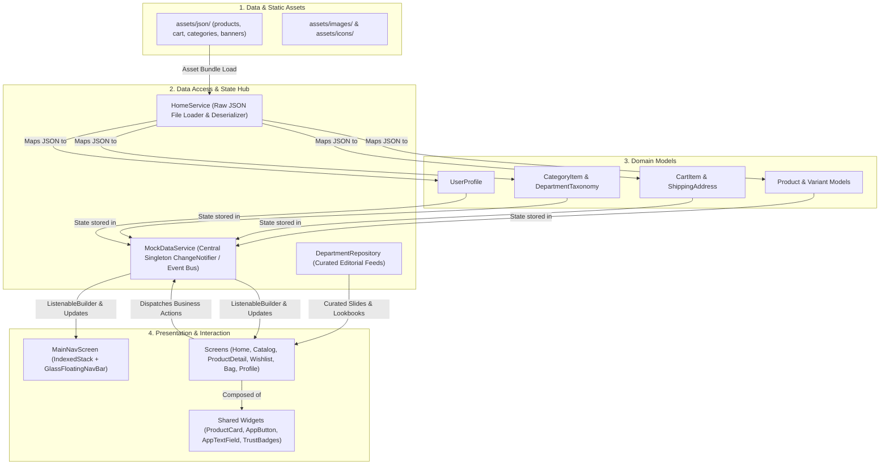
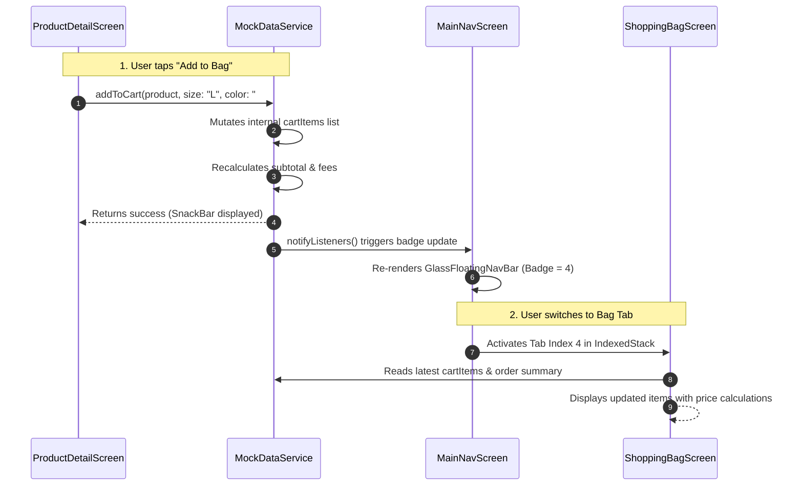

# MA E-Commerce: Architecture&#x20;

\
**Target Codebase**: `ecormmerce_ma` (Flutter Mobile)

---

## 1. Executive Summary & Product Vision

**MA E-Commerce** is a high-fashion mobile shopping application designed with an editorial, minimalist aesthetic inspired by luxury fashion ateliers.

### Core Value Proposition

- **Editorial Brand Experience**: High-impact editorial carousels, lookbooks, and department switching (Women, Men, Kids, Home, Accessories).
- **Frictionless Shopping Flow**: Low-latency browsing, instant wishlist toggling, quick size & quantity selectors, and real-time shopping bag counter badges.
- **Glassmorphic Navigation**: A floating frosted-glass bottom navigation bar providing seamless multi-tab multitasking via persistent indexed views.

---

## 2. Global Architecture Pattern: 4-Layer Separation

The system follows a clean **4-Layer Separation of Concerns**:



---

## 3. Exhaustive Folder & File Directory Blueprint

### 📁 Root Structure

| Path                                                                                                                                                                                                                                           | Contents                                                  | Business & Technical Purpose                                                    |
| :--------------------------------------------------------------------------------------------------------------------------------------------------------------------------------------------------------------------------------------------- | :-------------------------------------------------------- | :------------------------------------------------------------------------------ |
| [`android/`](file:///d:/Sv23/Flutter/MA/ecormmerce_ma/android)                                                                                                                                                                                 | Gradle build files, Kotlin MainActivity, Android Manifest | Android native runner, app permissions, package ID `com.example.ecormmerce_ma`. |
| [`ios/`](file:///d:/Sv23/Flutter/MA/ecormmerce_ma/ios)                                                                                                                                                                                         | Xcode project, Podfile, Info.plist                        | iOS native target configuration, status bar & safe area handling.               |
| [`web/`](file:///d:/Sv23/Flutter/MA/ecormmerce_ma/web), [`macos/`](file:///d:/Sv23/Flutter/MA/ecormmerce_ma/macos), [`windows/`](file:///d:/Sv23/Flutter/MA/ecormmerce_ma/windows), [`linux/`](file:///d:/Sv23/Flutter/MA/ecormmerce_ma/linux) | Multi-platform runners                                    | Cross-platform build targets.                                                   |
| [`assets/`](file:///d:/Sv23/Flutter/MA/ecormmerce_ma/assets)                                                                                                                                                                                   | Media files and JSON databases                            | Contains mock databases and high-resolution assets.                             |
| [`docs/`](file:///d:/Sv23/Flutter/MA/ecormmerce_ma/docs)                                                                                                                                                                                       | Architecture guides & design specs                        | Engineering handoff specifications and UI design tokens.                        |
| [`supabase/`](file:///d:/Sv23/Flutter/MA/ecormmerce_ma/supabase)                                                                                                                                                                               | Supabase configuration                                    | Directory reserved for cloud DB migrations and edge functions.                  |
| [`lib/`](file:///d:/Sv23/Flutter/MA/ecormmerce_ma/lib)                                                                                                                                                                                         | Dart application source                                   | The complete UI, business logic, models, and state handling.                    |

---

### 📁 Assets Subdirectories (`assets/`)

- [`assets/json/`](file:///d:/Sv23/Flutter/MA/ecormmerce_ma/assets/json):
  - `products.json`: Full product catalog including ID, title, brand, price, discounts, ratings, colors, and stock.
  - `categories.json`: Multi-tier department and category hierarchy (Women, Men, Kids, Accessories).
  - `banners.json`: Hero banner slides, sales countdown badges, and promotion cards.
  - `feature_products.json`: Curated showcase items (e.g., "Trending Now", "New Arrivals").
  - `cart.json`: Seed data for initial user shopping bag, coupon codes, and shipping fees.
  - `user_profile.json`: Mock authenticated customer details, order history, and default address.
- [`assets/images/`](file:///d:/Sv23/Flutter/MA/ecormmerce_ma/assets/images): High-resolution editorial campaign photos (`category/`, `products/`).
- [`assets/icons/`](file:///d:/Sv23/Flutter/MA/ecormmerce_ma/assets/icons): Vector SVGs and category icons (`category-horizental/`).

---

### 📁 Design Tokens & Utilities (`lib/helpers/`)

- [`app_colors.dart`](file:///d:/Sv23/Flutter/MA/ecormmerce_ma/lib/helpers/app_colors.dart): Single source of truth for color styling. Defines monochrome luxury tones (`black`, `darkGrey`, `border`, `surfaceLight`, `alertRed`).
- [`app_typography.dart`](file:///d:/Sv23/Flutter/MA/ecormmerce_ma/lib/helpers/app_typography.dart): Typography scale using Google Fonts Inter (`h1`, `h2`, `bodyMedium`, `price`, `badge`, `button`).
- [`app_dimensions.dart`](file:///d:/Sv23/Flutter/MA/ecormmerce_ma/lib/helpers/app_dimensions.dart): Spacing standards (`paddingSmall`, `paddingMedium`, `radiusLarge`, `navBarHeight`).
- [`color_extensions.dart`](file:///d:/Sv23/Flutter/MA/ecormmerce_ma/lib/helpers/color_extensions.dart): Converts HEX strings from API/JSON (`#FFFFFF`, `#1A1A1A`) into Flutter `Color` objects safely.
- [`currency_helper.dart`](file:///d:/Sv23/Flutter/MA/ecormmerce_ma/lib/helpers/currency_helper.dart): Formats raw integers/doubles into human-readable prices (`$140.00`).

---

### 📁 Domain Data Models (`lib/models/`)

- [`product.dart`](file:///d:/Sv23/Flutter/MA/ecormmerce_ma/lib/models/product.dart): Complete product entity with images, color options, sizes, stock, price, discount percentage, and rating.
- [`cart_item.dart`](file:///d:/Sv23/Flutter/MA/ecormmerce_ma/lib/models/cart_item.dart): Represents an added bag item including selected size, selected color hex, unit price, quantity, and product snapshot.
- [`category_item.dart`](file:///d:/Sv23/Flutter/MA/ecormmerce_ma/lib/models/category_item.dart): Category entity with banner image, product count, and department association.
- [`department_taxonomy.dart`](file:///d:/Sv23/Flutter/MA/ecormmerce_ma/lib/models/department_taxonomy.dart) & [`department_content.dart`](file:///d:/Sv23/Flutter/MA/ecormmerce_ma/lib/models/department_content.dart): Structured taxonomy linking departments (Men, Women, Kids) to hero banner slides, promo boxes, and lookbook edits.
- [`banner_item.dart`](file:///d:/Sv23/Flutter/MA/ecormmerce_ma/lib/models/banner_item.dart): Hero carousel slide model with CTA link, headline, and background image asset.
- [`user_profile.dart`](file:///d:/Sv23/Flutter/MA/ecormmerce_ma/lib/models/user_profile.dart): Customer profile containing personal info, shipping address, saved payment methods, and order receipts.

---

### 📁 Services & State Management (`lib/services/`)

- [`home_service.dart`](file:///d:/Sv23/Flutter/MA/ecormmerce_ma/lib/services/home_service.dart):
  - Async I/O engine. Reads local assets (`rootBundle.loadString`) and parses them into model instances.
  - Acts as the abstraction boundary that will later swap local JSON for REST or Supabase API calls.
- [`mock_data_service.dart`](file:///d:/Sv23/Flutter/MA/ecormmerce_ma/lib/services/mock_data_service.dart):
  - **The Central Nervous System**: Singleton `ChangeNotifier`.
  - Holds active session memory: `products`, `cartItems`, `wishlistProductIds`, `userProfile`, `promoCode`.
  - Exposes business methods:
    - `addToCart(Product, size, color, qty)`
    - `removeFromCart(cartItemId)`
    - `updateQuantity(cartItemId, newQty)`
    - `toggleWishlist(productId)`
    - `applyPromoCode(code)`
  - Broadcasts `notifyListeners()`, causing subscribed UI widgets to rebuild instantly.
- [`department_repository.dart`](file:///d:/Sv23/Flutter/MA/ecormmerce_ma/lib/services/department_repository.dart):
  - Supplies curated department campaigns (Women Runway Edit, Men Streetwear Heavyweight Cuts, Kids Drop, Atelier Accessories).

---

### 📁 Presentation: Reusable Shared Widgets (`lib/widgets/`)

- [`glass_nav_bar.dart`](file:///d:/Sv23/Flutter/MA/ecormmerce_ma/lib/widgets/glass_nav_bar.dart): Floating frosted-glass bottom nav bar with blur filter (`BackdropFilter`) and reactive badge counts for Bag and Wishlist.
- [`product_card.dart`](file:///d:/Sv23/Flutter/MA/ecormmerce_ma/lib/widgets/product_card.dart): Product catalog item card supporting aspect ratios, discount tags, wishlisting heart button, and price formatting.
- [`app_image.dart`](file:///d:/Sv23/Flutter/MA/ecormmerce_ma/lib/widgets/app_image.dart): Smart image loader that automatically decides whether an image is local asset (`assets/...`) or network URL (`http...`), showing smooth shimmer fallbacks.
- [`trust_badges.dart`](file:///d:/Sv23/Flutter/MA/ecormmerce_ma/lib/widgets/trust_badges.dart): Atelier guarantee footer (Global Express Shipping, 14-Day Returns, Authentic & Secure).
- [`app_button.dart`](file:///d:/Sv23/Flutter/MA/ecormmerce_ma/lib/widgets/app_button.dart) & [`app_text_field.dart`](file:///d:/Sv23/Flutter/MA/ecormmerce_ma/lib/widgets/app_text_field.dart): Standardized input fields and primary/outline action buttons.

---

### 📁 Feature Screens (`lib/screens/`)

```
screens/
├── main_nav_screen.dart           # App shell: IndexedStack holding 5 primary tabs
├── onboarding/                    # App introduction carousel & start shopping button
├── auth/                          # Customer access (sign-in & sign-up forms)
├── home/                          # Home feed: tabs, banners, carousels, editorial grids
├── category/                      # Category taxonomy & department navigation
├── catalog/                       # Product grid & filtering modal
├── product/                       # Product detail, photo gallery & sizing sheet
├── wishlist/                      # Saved items & quick move-to-bag modal
├── bag/                           # Shopping cart, promo codes & checkout summary
└── profile/                       # User account, orders & address settings
```

#### Screen Module Roles

1. **[`main_nav_screen.dart`](file:///d:/Sv23/Flutter/MA/ecormmerce_ma/lib/screens/main_nav_screen.dart)**:
   - Root scaffold containing an `IndexedStack` with 5 views:
     - Index 0: `HomeScreen`
     - Index 1: `CategoryScreen`
     - Index 2: `WishlistScreen`
     - Index 3: `UserProfileScreen`
     - Index 4: `ShoppingBagScreen`
   - Handles tab transitions and Android hardware back button via `PopScope`.

2. **[`screens/home/`](file:///d:/Sv23/Flutter/MA/ecormmerce_ma/lib/screens/home)**:
   - Header with search trigger and department tab bar (`Women`, `Men`, `Kids`, etc.).
   - Hero carousel ([`home_hero_carousel.dart`](file:///d:/Sv23/Flutter/MA/ecormmerce_ma/lib/screens/home/widgets/home_hero_carousel.dart)).
   - Horizontal category strip ([`category_horizontal_list.dart`](file:///d:/Sv23/Flutter/MA/ecormmerce_ma/lib/screens/home/widgets/category_horizontal_list.dart)).
   - Promo banners and editorial lookbook cards ([`editorial_lookbook_card.dart`](file:///d:/Sv23/Flutter/MA/ecormmerce_ma/lib/screens/home/widgets/editorial_lookbook_card.dart)).
   - Trending & Recommended feeds ([`product_horizontal_list.dart`](file:///d:/Sv23/Flutter/MA/ecormmerce_ma/lib/screens/home/widgets/product_horizontal_list.dart)).

3. **[`screens/catalog/`](file:///d:/Sv23/Flutter/MA/ecormmerce_ma/lib/screens/catalog)**:
   - [`product_list_screen.dart`](file:///d:/Sv23/Flutter/MA/ecormmerce_ma/lib/screens/catalog/product_list_screen.dart): 2-column responsive product grid with sorting and category filtering.
   - [`filter_bottom_sheet.dart`](file:///d:/Sv23/Flutter/MA/ecormmerce_ma/lib/screens/catalog/filter_bottom_sheet.dart): Modal sheet filtering by price range, department, size, and sorting criteria.

4. **[`screens/product/`](file:///d:/Sv23/Flutter/MA/ecormmerce_ma/lib/screens/product)**:
   - [`product_detail_screen.dart`](file:///d:/Sv23/Flutter/MA/ecormmerce_ma/lib/screens/product/product_detail_screen.dart): Full product showcase.
   - Image carousel with dot indicator ([`product_gallery_carousel.dart`](file:///d:/Sv23/Flutter/MA/ecormmerce_ma/lib/screens/product/widgets/product_gallery_carousel.dart)).
   - Color picker swatches ([`product_color_selector.dart`](file:///d:/Sv23/Flutter/MA/ecormmerce_ma/lib/screens/product/widgets/product_color_selector.dart)).
   - Sizing chips & interactive Size Guide sheet ([`size_guide_sheet.dart`](file:///d:/Sv23/Flutter/MA/ecormmerce_ma/lib/screens/product/size_guide_sheet.dart)).
   - Sticky bottom action bar ([`product_bottom_bar.dart`](file:///d:/Sv23/Flutter/MA/ecormmerce_ma/lib/screens/product/widgets/product_bottom_bar.dart)) with "Add to Bag" and wishlist heart toggle.

5. **[`screens/wishlist/`](file:///d:/Sv23/Flutter/MA/ecormmerce_ma/lib/screens/wishlist)**:
   - Shows all products matching IDs in `MockDataService.wishlistProductIds`.
   - Supports quick move to bag via bottom sheet size picker ([`size_picker_bottom_sheet.dart`](file:///d:/Sv23/Flutter/MA/ecormmerce_ma/lib/screens/wishlist/widgets/size_picker_bottom_sheet.dart)).

6. **[`screens/bag/`](file:///d:/Sv23/Flutter/MA/ecormmerce_ma/lib/screens/bag)**:
   - Displays line items with photo, size, color swatch, unit price, and quantity picker.
   - Promo code input box (validates `FIRST20` and applies discounts).
   - Order summary (subtotal, shipping, discount, final total).
   - Sticky Checkout CTA.

7. **[`screens/profile/`](file:///d:/Sv23/Flutter/MA/ecormmerce_ma/lib/screens/profile)** **&** **[`screens/auth/`](file:///d:/Sv23/Flutter/MA/ecormmerce_ma/lib/screens/auth)**:
   - Profile view displaying account status, active orders, saved addresses, and payment methods.
   - Onboarding and authentication flows.

---

## 4. Inter-Component Communication & Data Flow

### Communication Matrix



### Communication Principles

1. **No Direct Screen-to-Screen Mutation**: Screens do not directly manipulate another screen's state. All changes are committed to `MockDataService`.
2. **Reactive Observation**: Views that display dynamic data (e.g. badge counters or cart totals) wrap their layout in a `ListenableBuilder(listenable: MockDataService())`.
3. **Decoupled Callbacks**: Child widgets emit callbacks (`onTap`, `onChanged`, `onSizeSelected`) to their parent controllers, keeping widgets generic and reusable.

---

## 5. PO Production Roadmap & Milestones

```
Milestone 1: Backend Integration (Supabase)
├── Replace HomeService local asset loaders with Supabase REST client
├── Create PostgreSQL tables: products, categories, cart_items, profiles
└── Enable real authentication (Email/Password, Google OAuth)

Milestone 2: Payment & Checkout Flow
├── Integrate Stripe / Apple Pay / Google Pay SDK
├── Add real address validation and shipping carrier calculation
└── Generate order invoices and payment confirmation webhooks

Milestone 3: Enhanced UX & Deep-Linking
├── Migrate imperative Navigator to GoRouter for clean URLs and universal links
└── Implement offline caching with Hive / Isar for instant launch times
```
